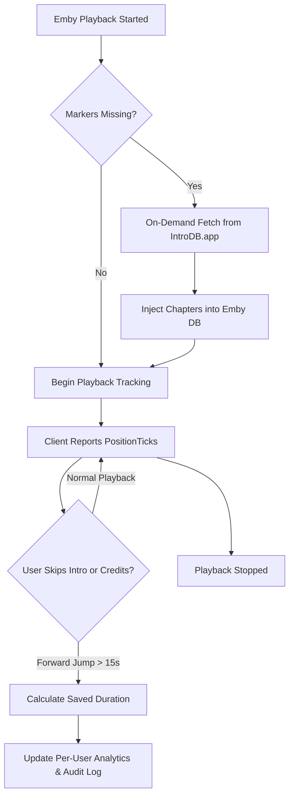

# IntroDB.app Plugin for Emby Server

[](https://github.com/)
[](https://emby.media/)
[](LICENSE)
[](https://introdb.app/)

Autonomous and hybrid plugin for **Emby Server** that automatically detects, fetches, and injects **Intro**, **Outro / End Credits**, and **Post-Credit scene** timestamps into your media library via the open community ecosystem of [IntroDB.app](https://introdb.app).

---

## 🌟 Key Highlights

- **Universal Client Compatibility:** Works out of the box with all official Emby clients (Web, Android, iOS, Apple TV, Smart TVs) as well as popular third-party players like **Infuse**, **Kodi** (EmbyCon/Jellyfin sync), and VLC.
- **No Emby Premiere Required:** Native chapter marker injection (`MarkerType.IntroStart`, `MarkerType.IntroEnd`, `MarkerType.CreditsStart`) allows non-Premiere servers and clients to jump through intros and credits seamlessly.
- **Real-Time Playback Tracking:** Automatically detects forward jumps and skips during playback via server-side session tracking, measuring saved time per user profile.
- **Automated On-Demand & Ingestion Scanning:** Injects markers the instant a media item is played or newly added to your library.
- **Direct Community Submissions:** Submit verified timestamps directly to IntroDB.app from Emby's dashboard with live API verification and rate-limit tracking.
- **Adaptive UI Design:** Modern, responsive dashboard interface adapting dynamically to Emby Dark, Light, and custom themes without hardcoded color clashes.

---

## ⚙️ Operation Modes

The plugin supports four distinct operating strategies to suit any server setup:

| Mode | Name | Description |
|---|---|---|
| ⭐ `IntroDbPrimary` *(Default)* | **IntroDB First** | Prioritizes IntroDB.app for all titles. Items without community data safely fall back to TheIntroDB or existing local markers. |
| 🔄 `Hybrid` | **TheIntroDB First** | Prioritizes TheIntroDB. IntroDB.app acts as an intelligent safety net to recover missing intros and credits. |
| 🛡️ `Standalone` | **Autonomous** | Operates exclusively with IntroDB.app, independent of any secondary providers. |
| ⚡ `Overwrite` | **Force Overwrite** | Overwrites all existing chapter markers with verified data from IntroDB.app. |

---

## 🚀 Installation

### Option 1: Manual Installation (Recommended for quick testing)

1. Download the latest `Emby.Plugin.IntroDbApp.dll` (or `Emby.Plugin.IntroDbApp.zip`) from the [Releases](https://github.com/) page.
2. Copy the DLL into your Emby Server `plugins` directory:
   - **Linux / Docker:** `/var/lib/emby/plugins/` (or your Docker volume mount)
   - **Windows:** `%APPDATA%\Emby-Server\programdata\plugins\`
   - **macOS:** `~/Library/Application Support/Emby-Server/plugins/`
3. Ensure file ownership matches your Emby service user (e.g. `chown emby:emby Emby.Plugin.IntroDbApp.dll` and `chmod 644`).
4. Restart your Emby Server:
   ```bash
   sudo systemctl restart emby-server
   ```
5. Open your Emby Dashboard, navigate to **Plugins**, and click **IntroDB.app** (under *Advanced* or the main menu).

### Option 2: Emby Plugin Catalog / Custom Repository

Once added to the official catalog or custom manifest:
1. Go to **Dashboard > Plugins > Catalog**.
2. Locate **IntroDB.app** under the *Playback* or *General* category.
3. Click **Install** and restart your server when prompted.

---

## 📊 Live Tools & Diagnostics

The plugin includes an integrated **"🛠 Tools & Inspector"** tab in the Emby Dashboard:

1. **Specific Item Scanner:** Fetch and inject markers for an entire series or movie using its IMDb ID with a single click.
2. **Internal Diagnostic Center:** Inspect internal chapter structures, verify native markers (`IntroStart`, `IntroEnd`, `CreditsStart`), and view exact second offsets.
3. **Playback Skip Simulator:** Test user analytics and verify time savings without having to watch through entire episodes.
4. **Live IntroDB.app Inspector:** Query the upstream IntroDB REST API in real time for any IMDb ID, Season, or Episode.
5. **Community Segment Contributor:** Submit newly identified timestamps directly to IntroDB.app with instant input sanitization and automatic form clearing.

---

## 🏗️ Architecture & Playback Flow

The plugin listens to Emby's `ISessionManager` and `ILibraryManager` events to provide frictionless synchronization:



---

## 🛠️ Building from Source

### Prerequisites
- [.NET 8.0 SDK](https://dotnet.microsoft.com/download/dotnet/8.0) or higher.
- `git`

### Compilation Steps

```bash
# Clone the repository
git clone https://github.com/AndyCiprian/Emby.Plugin.IntroDbApp.git
cd Emby.Plugin.IntroDbApp

# Build in Release configuration
dotnet build Emby.Plugin.IntroDbApp.csproj -c Release -o ./bin

# The compiled plugin will be available at:
# ./bin/Emby.Plugin.IntroDbApp.dll
```

---

## 🔐 API Reference & Privacy

- All API communications target the official **IntroDB.app** endpoint: `https://api.introdb.app/`.
- No personal data, library file paths, user credentials, or IP addresses are ever transmitted upstream.
- Only public IMDb identifiers and timestamp ranges (`start_sec`, `end_sec`) are exchanged.
- An optional [IntroDB API Key](https://introdb.app/docs/api#submit-api-key) can be configured to submit community segments and receive higher rate limits.

---

## 👤 Author

Developed with ❤️ by **Andy Ernesto Ciprian Ciprian**
- GitHub: [@AndyCiprian](https://github.com/AndyCiprian)

## 📄 License

This project is licensed under the [MIT License](LICENSE).
Emby Server is a registered trademark of Emby LLC. This project is an independent community development.
